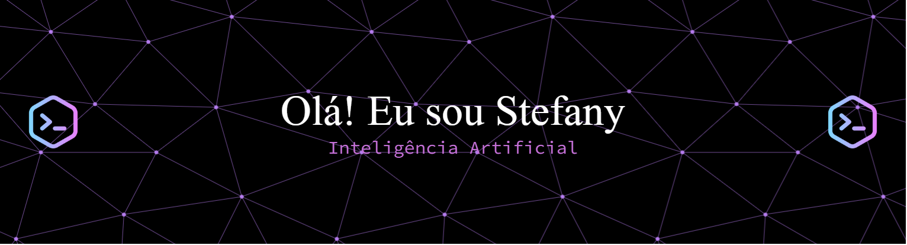

 

  

  

  
  
  
  
  
  
  

  
  
  
  
  
  

  <strong>4º período de Ciência da Computação na UFCG</strong>
   
  Pesquisa acadêmica · Monitoria de programação · Inteligência artificial
    
  
  

---

## Sobre mim

Sou estudante de Ciência da Computação na Universidade Federal de Campina Grande (UFCG), interessada em inteligência artificial, desenvolvimento de software, dados e algoritmos.

Antes de ingressar em Computação, cursei Física Bacharelado e participei de uma iniciação científica em Cosmologia. Essa experiência me proporcionou contato com pesquisa acadêmica, análise de problemas científicos e escrita e apresentação de resultados.

Na Computação, fui monitora de Laboratório de Programação II, auxiliando estudantes nas atividades práticas e no desenvolvimento de suas soluções. Atualmente, participo do **Agents4Good**, projeto em parceria com a **Kunumi**, no qual tenho a oportunidade de aprofundar meus conhecimentos em inteligência artificial e explorar aplicações de agentes inteligentes.

Gosto de compreender como as coisas funcionam, estudar novas tecnologias e transformar conceitos em projetos práticos. Busco desenvolver soluções com código bem estruturado, raciocínio lógico e atenção à qualidade dos resultados.

## Estatísticas do GitHub

  
  

  

